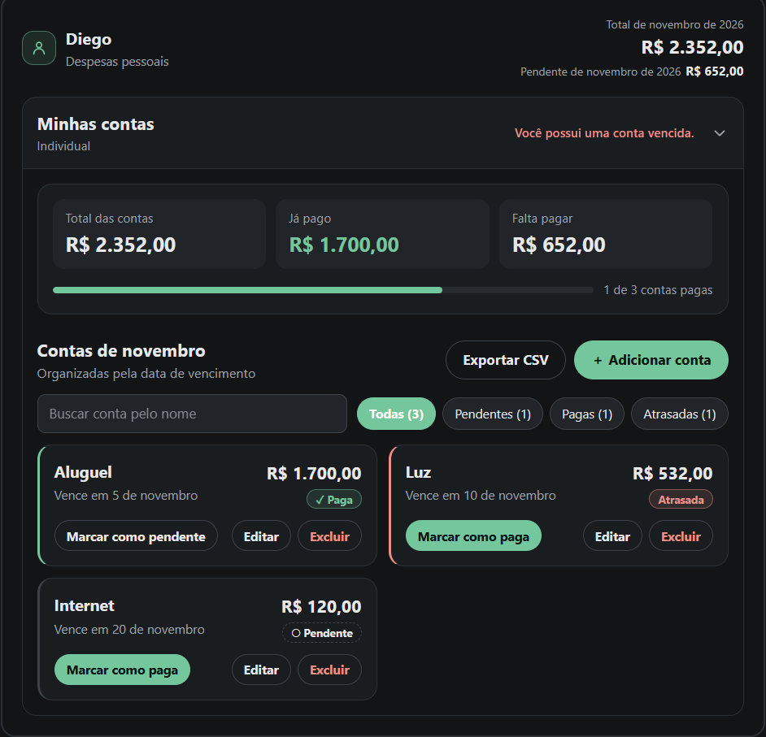
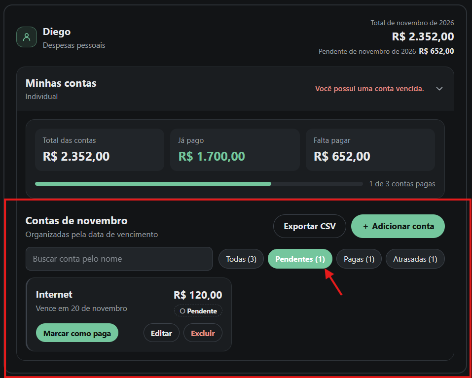

# BUG-002 — Filtro "Pendentes" não exibe contas atrasadas

## História relacionada

US-102 — Filtrar contas por situação.

## Casos de teste relacionados

- CT-102-01 — Filtro padrão: Todas.
- CT-102-02 — Filtro Pendentes inclui contas atrasadas.
- CT-102-05 — Atualização dos filtros ao marcar uma conta como paga.
- CT-102-06 — Atualização dos filtros ao desmarcar uma conta como paga.

## Severidade

Média.

## Prioridade sugerida

Média.

## Ambiente

- Branch: `develop`
- Commit: `68721c9`
- Navegador e versão: Microsoft Edge 157.0.4341.60 (Compilação oficial) (64 bits)
- Sistema operacional: Windows 11

## Issue

A criar (repositório ainda não publicado).

## Pré-condição

- A área Minhas contas deve possuir contas não pagas com vencimentos anteriores e posteriores à data atual.

## Passos para reproduzir

1. Acessar a aplicação.
2. Expandir "Minhas contas".
3. Verificar se as contas "Luz" e "Internet" são exibidas.
4. Selecionar a opção "Pendentes".
5. Verificar quais contas permanecem na lista.
6. Conferir a quantidade apresentada no filtro.

## Dados

- Conta 1: Aluguel — vencimento dia 5 — R$ 1.700,00, paga.
- Conta 2: Luz — vencimento dia 10 — R$ 532,00, não paga.
- Conta 3: Internet — vencimento dia 20 — R$ 120,00, não paga.
- Data de referência: dia 17 do mês.

## Resultado esperado

- Ao selecionar "Pendentes", devem ser exibidas as contas "Luz" e "Internet".
- A conta atrasada "Luz" também deve permanecer na lista, pois ainda não foi paga.
- A opção "Pendentes (2)" deve ser exibida.

## Resultado obtido

- Ao selecionar "Pendentes", só a conta "Internet" aparece.
- A conta "Luz" (vencida no dia 10 e não paga) não aparece.
- O contador mostra "Pendentes (1)", e não "Pendentes (2)".
- O resumo mostra "Falta pagar R$ 652,00" (Luz + Internet), mas o filtro mostra "Pendentes (1)" e exibe só a Internet. Pela regra da US-102, os dois deveriam considerar as mesmas contas.

## Evidência

- 

- 

- 

- [Assistir à gravação CT-102-05](../evidencias/CT-102-05.mp4)

- [Assistir à gravação CT-102-06](../evidencias/CT-102-06.mp4)

## Observações

- **Frequência:** sempre.
- **Contorno:** Para ver tudo o que falta pagar, usar "Todas" ou consultar "Pendentes" e "Atrasadas" separadamente.
- **Outras áreas afetadas:** O mesmo comportamento se repete em "Gastos da casa".
