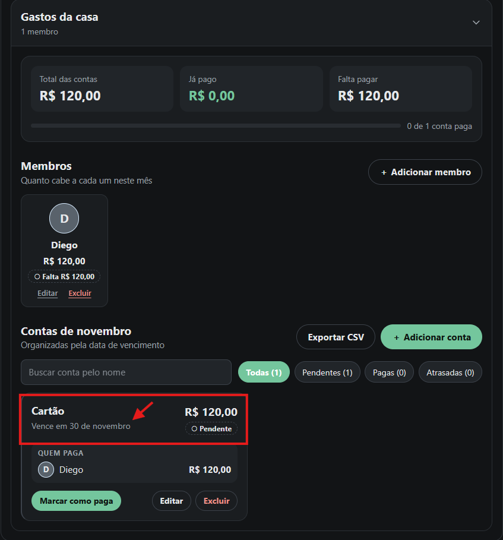
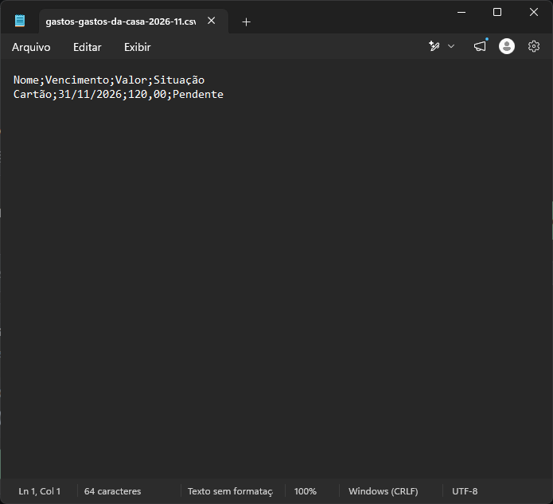
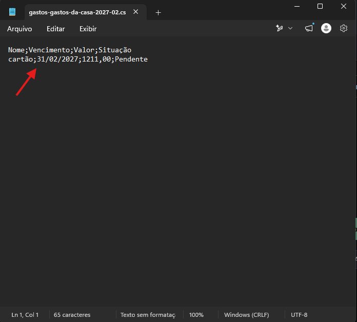

# BUG-003 — CSV exporta data de vencimento inexistente (ex.: 31/11, 31/02) quando o dia cadastrado não existe no mês

## História relacionada

US-103 — Exportar as contas do mês em CSV.

## Caso de teste relacionado

CT-103-06 — Verificar o formato do vencimento no arquivo CSV.

## Severidade

Média.

## Prioridade sugerida

Média.

## Ambiente

- Branch: `develop`
- Commit: `68721c9`
- Navegador e versão: Microsoft Edge 157.0.4341.60 (Compilação oficial) (64 bits)
- Sistema operacional: Windows 11

## Issue

A criar (repositório ainda não publicado).

## Pré-condição

- A área "Gastos da casa" deve possuir contas cadastradas no mês de novembro de 2026.
- Uma das contas deve possuir vencimento no dia 31.

## Passos para reproduzir

1. Acessar a aplicação.
2. Navegar até novembro de 2026.
3. Expandir "Gastos da casa".
4. Localizar a conta "Cartão".
5. Verificar a data de vencimento apresentada na tela.
6. Clicar em "Exportar CSV".
7. Abrir o arquivo baixado.
8. Verificar a data de vencimento da conta "Cartão".

## Dados de teste

- Conta: Cartão.
- Mês: novembro de 2026.
- Dia de vencimento cadastrado: 31.

## Resultado esperado

- No CSV, o vencimento da conta "Cartão" deve ser `30/11/2026`, a mesma data mostrada na tela.
- Quando o dia cadastrado não existe no mês, o vencimento deve ser o último dia do mês, como a tela já faz.

## Resultado obtido

- Na tela, a conta "Cartão" mostra "Vence em 30 de novembro".
- No CSV, a mesma conta sai com o vencimento `31/11/2026`, uma data que não existe.
- A tela e o arquivo mostram vencimentos diferentes para a mesma conta.

## Evidência

[Assistir à gravação CT-103-06](../evidencias/CT-103-06a.mp4)

## Observações

- **Frequência:** sempre.
- **Contorno:** Corrigir manualmente a data no arquivo CSV (ou no Excel) após a exportação.
- **Outras áreas afetadas:** o mesmo comportamento se repete em "Minhas contas".
- **Outros meses afetados:** em fevereiro de 2027, uma conta com vencimento no dia 31 aparece na tela como "Vence em 28 de fevereiro", mas no CSV sai como `31/02/2027`.

