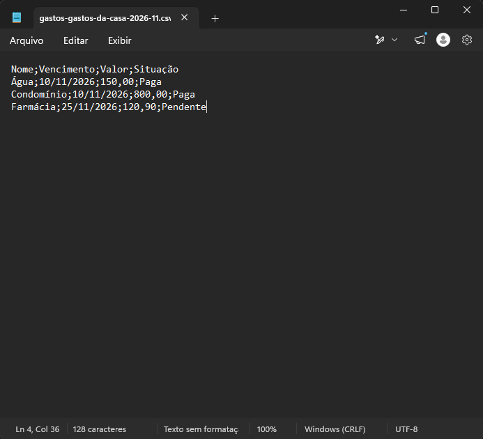
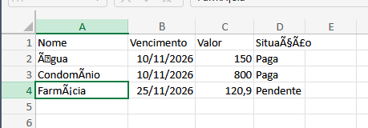

# BUG-004 — Acentos aparecem corrompidos ao abrir o CSV exportado no Excel (ex.: "Ã�gua" em vez de "Água")

## História relacionada

US-103 — Exportar as contas do mês em CSV.

## Casos de teste relacionados

- CT-103-09 — Verificar a abertura do CSV no Excel Online em português.
- CT-103-10 — Exportar contas com nomes que possuem ponto e vírgula ou aspas.

## Severidade

Média. Os dados são exportados corretamente e as colunas são separadas, mas todo texto com acento fica ilegível ao abrir o arquivo no Excel.

## Prioridade sugerida

Alta. A abertura no Excel é o objetivo principal da US-103, e quase todos os nomes de contas em português têm acento.

## Ambiente

- Branch: `develop`
- Commit: `68721c9`
- Navegador e versão: Microsoft Edge 157.0.4341.60 (Compilação oficial) (64 bits)
- Planilha: Microsoft Excel Online, em português (o Excel instalado não foi testado)
- Sistema operacional: Windows 11

## Issue

A criar (repositório ainda não publicado).

## Pré-condição

- A área "Gastos da casa" deve possuir contas cadastradas com nomes que contenham acentos.
- Acesso ao Microsoft Excel Online pelo navegador, com o idioma em português.

## Passos para reproduzir

1. Acessar a aplicação.
2. Expandir "Gastos da casa".
3. Clicar em "Exportar CSV".
4. Localizar o arquivo baixado.
5. Abrir o Excel Online no navegador, carregar o arquivo baixado e abri-lo.
6. Conferir se os nomes e cabeçalhos com acentos são exibidos corretamente.
7. Abrir o mesmo arquivo com Bloco de Notas para comparação.

## Dados de teste

- Conta 1: Água.
- Conta 2: Condomínio.
- Conta 3: Farmácia.
- Cabeçalho: Situação.

## Resultado esperado

- Os acentos devem ser exibidos corretamente, incluindo "Água", "Condomínio", "Situação" e "Farmácia".

## Resultado obtido

- Os acentos não são exibidos corretamente:
  - "Água" aparece como "Ã�gua".
  - "Condomínio" aparece como "Condomínio".
  - "Farmácia" aparece como "Farmácia".
  - "Situação" aparece como "Situação".
- No Bloco de Notas, o mesmo arquivo mostra os acentos corretamente ("Água", "Condomínio", "Farmácia", "Situação").
- As colunas são separadas corretamente; o problema afeta apenas os textos com acento.

## Evidência

[Exportação do CSV](../evidencias/CT-103-09a.mp4)

[Abertura no Excel Online](../evidencias/CT-103-09b.mp4)

## Observações

- **Frequência:** Sempre.
- **Contorno:** Nenhum contorno encontrado no Excel Online. O arquivo pode ser lido corretamente no Bloco de Notas, mas sem as colunas separadas.
- **Outras áreas afetadas:** não testado em outras áreas.
- **Nomes com caracteres especiais:** o mesmo comportamento aparece em nomes com ponto e vírgula e aspas (CT-103-10): "Água; Condominio." aparece como "Ã�gua; Condominio.", enquanto "Conta "Especial"" e "Internet" aparecem corretos. O problema está nos acentos, não no ponto e vírgula ou nas aspas.

## Reteste

- **Data:** 18/11/2026
- **Ambiente:** `develop` @ `6123d8b`, Edge 157, Windows 11, Microsoft Excel Online, em português (o Excel instalado não foi testado).
- **Verificado:** passos 1 a 7 em "Minhas contas" e "Gastos da casa"; os acentos aparecem de forma correta ao abrir o CSV exportado no Excel e no Bloco de Notas.
- **Resultado:** Corrigido.
- **Evidência:**
  - [Minhas contas: exportação do CSV](../evidencias/BUG-004-reteste-A1.mp4)
  - [Minhas contas: CSV aberto no Excel Online](../evidencias/BUG-004-reteste-A2.mp4)
  - [Minhas contas: CSV no Bloco de Notas (UTF-8 com BOM)](../evidencias/BUG-004-reteste-A3.png)
  - [Gastos da casa: exportação do CSV](../evidencias/BUG-004-reteste-B1.mp4)
  - [Gastos da casa: CSV aberto no Excel Online](../evidencias/BUG-004-reteste-B2.mp4)
  - [Gastos da casa: CSV no Bloco de Notas (UTF-8 com BOM)](../evidencias/BUG-004-reteste-B3.png)
