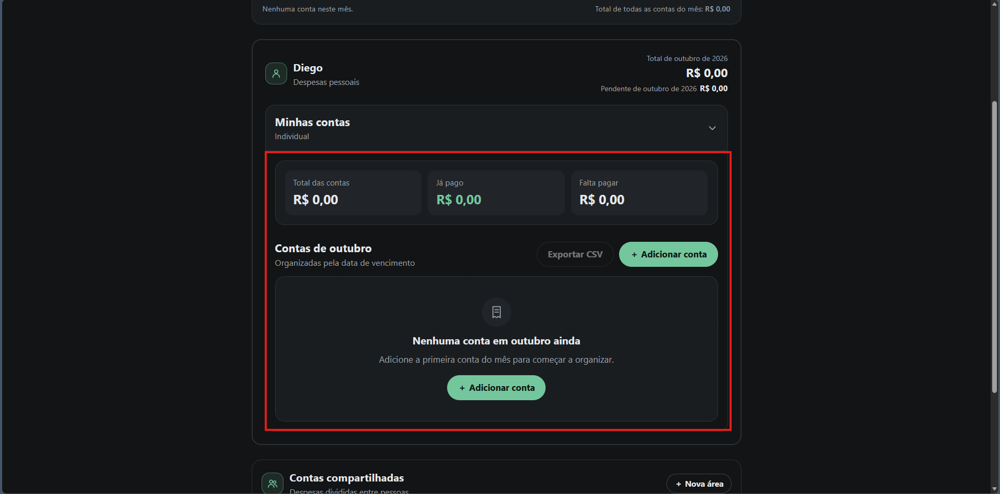
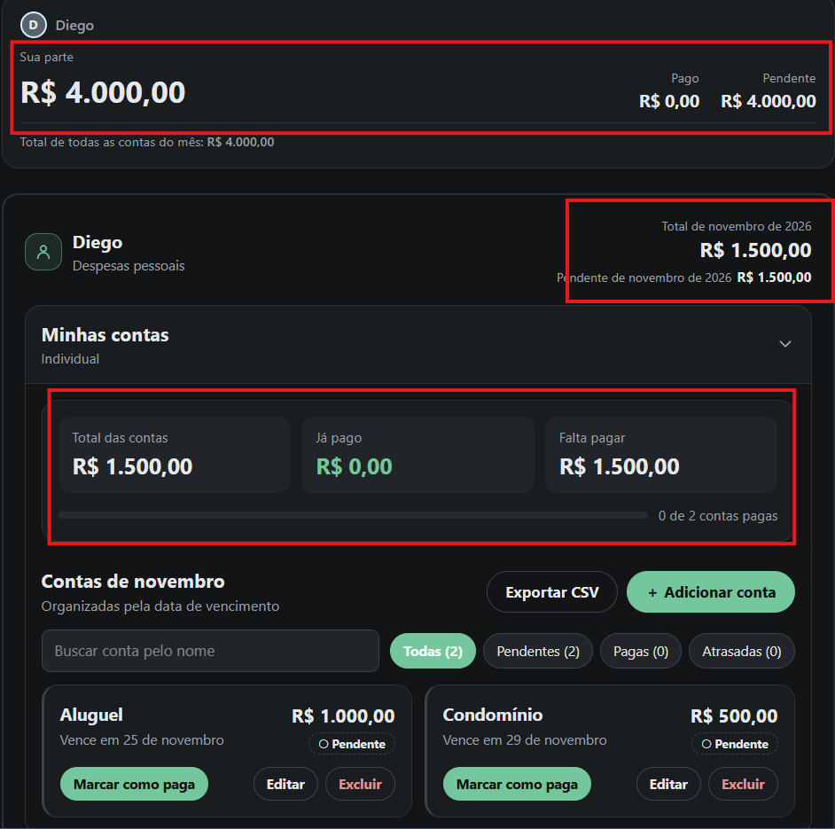
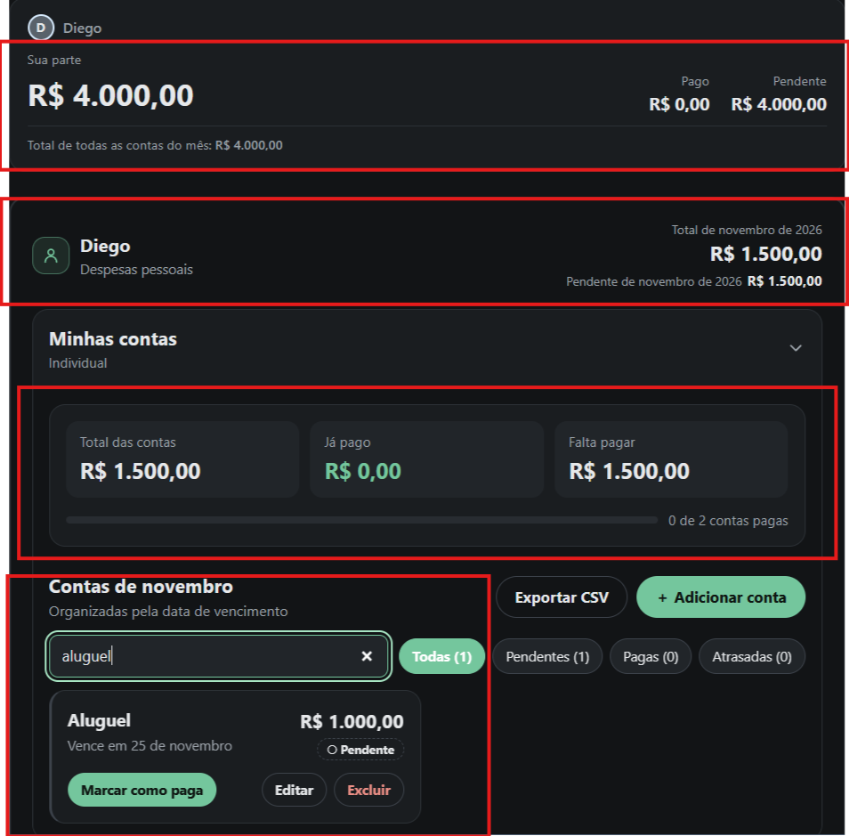
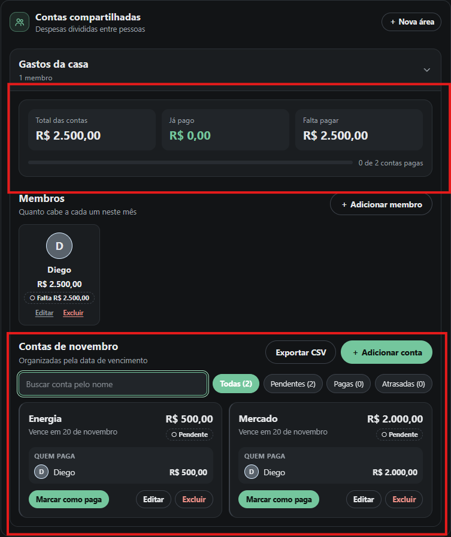
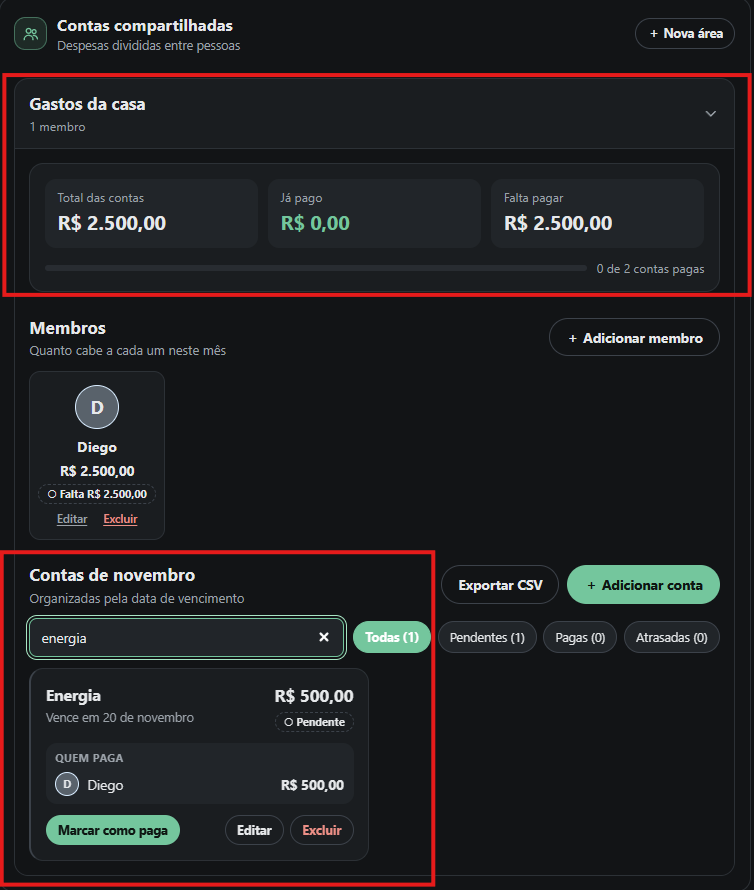
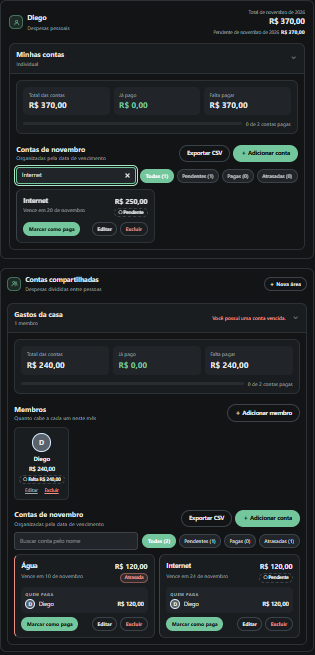
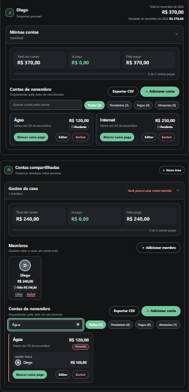

# Casos de teste: US-101 (Busca de conta pelo nome)

**Ambiente:** develop @ 68721c9, Microsoft Edge 157.0.4341.60 (Compilação oficial) (64 bits), Windows 11.

## CT-101-01 — Busca por parte do nome

**Pré-condição:**

- A área Minhas contas deve possuir as contas Internet e Água cadastradas.

**Passos:**

1. Acessar a página.
2. Expandir "Minhas contas".
3. Verificar se as contas "Internet" e "Água" são exibidas.
4. Clicar em "Buscar conta pelo nome".
5. Digitar "net" no campo de busca.

**Dados de teste:**

- Conta 1: Internet.
- Conta 2: Água.
- Termo de busca: `net`.

**Resultado esperado:**

- Ao digitar `net` no campo "Buscar conta pelo nome", deve ser exibida somente a conta "Internet".

**Resultado obtido:**

- Ao digitar `net` no campo "Buscar conta pelo nome", somente a conta "Internet" é exibida.

**Situação:** Passou.

**Evidência:**

[Assistir à gravação CT-101-01](../evidencias/CT-101-01.mp4)

## CT-101-02 — Busca sem diferenciar maiúsculas

**Pré-condição:**

- A área Minhas contas deve possuir a conta Internet cadastrada.

**Passos:**

1. Acessar a página.
2. Expandir "Minhas contas".
3. Verificar se a conta "Internet" é exibida.
4. Clicar em "Buscar conta pelo nome".
5. Digitar 'INTERNET' no campo de busca.

**Dados de teste:**

- Conta 1: Internet.
- Conta 2: Água.
- Termo de busca: 'INTERNET'.

**Resultado esperado:**

- Ao digitar 'INTERNET' no campo "Buscar conta pelo nome", deve ser exibida a conta "Internet".

**Resultado obtido:**

- Ao digitar 'INTERNET' no campo "Buscar conta pelo nome", somente a conta "Internet" é exibida.

**Situação:** Passou.

**Evidência:**

[Assistir à gravação CT-101-02](../evidencias/CT-101-02.mp4)

## CT-101-03 — Busca sem diferenciar acentos.

**Pré-condição:**

- A área Minhas contas deve possuir as contas "Água" e "Condomínio" cadastradas.

**Passos:**

1. Acessar a página.
2. Expandir "Minhas contas".
3. Verificar se as contas "Água" e "Condomínio" são exibidas.
4. Clicar em "Buscar conta pelo nome".
5. Digitar 'agua' no campo de busca.
6. Limpar o campo de busca.
7. Digitar 'condominio' no campo de busca.

**Dados de teste:**

- Conta 1: Água.
- Conta 2: Condomínio.
- Termo de busca: 'agua'.
- Termo de busca: 'condominio'.

**Resultado esperado:**

- Ao digitar 'agua' no campo "Buscar conta pelo nome", deve ser exibida a conta "Água".
- Ao digitar 'condominio' no campo "Buscar conta pelo nome", deve ser exibida a conta "Condomínio".

**Resultado obtido:**

- Ao digitar 'agua' no campo "Buscar conta pelo nome", nenhuma conta é exibida.
- Ao digitar 'condominio' no campo "Buscar conta pelo nome", nenhuma conta é exibida.

**Situação:** Falhou.

**Evidência:**

- [Busca por 'agua'](../evidencias/CT-101-03-agua.mp4)
- [Busca por 'condominio'](../evidencias/CT-101-03-condominio.mp4)

## CT-101-04 — Busca sem resultado.

**Pré-condição:**

- A área Minhas contas deve possuir pelo menos uma conta registrada.

**Passos:**

1. Acessar a página.
2. Expandir "Minhas contas".
3. Clicar em "Buscar conta pelo nome".
4. Digitar 'xyz' no campo de busca.
5. Clicar em "Limpar busca e filtro".

**Dados de teste:**

- Termo de busca: 'xyz'.

**Resultado esperado:**

- Ao digitar 'xyz' no campo "Buscar conta pelo nome", a mensagem "Nenhuma conta encontrada" deve ser exibida, logo após o botão "Limpar busca e filtro" deve ser exibido e ao clicar no botão a lista completa de contas deve voltar.

**Resultado obtido:**

- Ao digitar 'xyz' no campo "Buscar conta pelo nome", a mensagem "Nenhuma conta encontrada" é exibida, o botão "Limpar busca e filtro" aparece e ao clicar nele, a lista completa volta.

**Situação:** Passou.

**Evidência:**

[Assistir à gravação CT-101-04](../evidencias/CT-101-04.mp4)

## CT-101-05 — Mês sem contas.

**Pré-condição:**

- O mês selecionado não deve possuir contas.

**Passos:**

1. Acessar a página.
2. Expandir "Minhas contas".
3. Navegar até outubro de 2026, mês sem contas.

**Dados de teste:**

Não há necessidade de dados.

**Resultado esperado:**

- Ao expandir a área "Minhas contas" e a mesma não possuir contas, o campo de buscas não deve ser exibido.

**Resultado obtido:**

- Ao expandir a área de "Minhas contas" e visualizar que ela está vazia, a barra de "Buscar conta pelo nome" não aparece.

**Situação:** Passou.

**Evidência:**

## CT-101-06 — O campo aceita até 50 caracteres.

**Pré-condição:**

- A área Minhas contas deve possuir pelo menos uma conta registrada para que o campo "Buscar conta pelo nome" seja exibido.

**Passos:**

1. Acessar a página.
2. Expandir "Minhas contas".
3. Digitar os 49 caracteres no campo de busca.
4. Verificar se os 49 caracteres foram aceitos.
5. Limpar o campo.
6. Digitar os 50 caracteres.
7. Verificar se os 50 caracteres foram aceitos.
8. Tentar inserir o 51º caractere, letra b.
9. Verificar se o campo impede a inserção.

**Dados de teste:**

- 49 caracteres: 'aaaaaaaaaaaaaaaaaaaaaaaaaaaaaaaaaaaaaaaaaaaaaaaaa'
- 50 caracteres: 'aaaaaaaaaaaaaaaaaaaaaaaaaaaaaaaaaaaaaaaaaaaaaaaaaa'

**Resultado esperado:**

- O campo deve aceitar os 50 caracteres informados. Ao tentar inserir o 51º caractere, ele não deve ser adicionado.

**Resultado obtido:**

- 49 caracteres: aceitos.
- 50 caracteres: aceitos.
- 51 caracteres: não foi adicionado.

**Situação:** Passou.

**Evidência:**

[Assistir à gravação CT-101-06](../evidencias/CT-101-06-limite-de-caracteres.mp4)

## CT-101-07 — Verificar se a busca mantém os resumos financeiros inalterados.

**Pré-condição:**

- Ter pelo menos duas contas cadastradas no mês, com valores conhecidos.

**Passos:**

1. Acessar a aplicação.
2. Expandir a área "Minhas contas".
3. Registrar os valores apresentados nos resumos financeiros.
4. Pesquisar uma das contas cadastradas.
5. Verificar se os valores dos resumos continuam iguais aos registrados anteriormente.
6. Limpar a busca.
7. Repetir o procedimento na área "Gastos da casa".

**Dados de teste:**

Minhas contas:
- Aluguel: R$ 1.000,00.
- Condomínio: R$ 800,00.

Gastos da casa:
- Energia: R$ 500,00.
- Mercado: R$ 2.000,00.

**Resultado esperado:**

- Os resumos devem continuar apresentando os mesmos valores, independentemente do filtro de busca.

**Resultado obtido:**

- Após realizar os passos descritos, foi possível verificar que os valores apresentados nos resumos financeiros permaneceram iguais aos registrados antes da aplicação do filtro de busca.

**Situação:** Passou.

**Evidência:**

**Minhas contas — Antes da busca**

**Minhas contas — Após a busca por Aluguel**

**Gastos da casa — Antes da busca**

**Gastos da casa — Após a busca por Energia**

## CT-101-08 — Espaços no começo e no fim do texto são ignorados.

**Pré-condição:**

- A área Minhas contas deve possuir as contas "Internet" e "Água" cadastradas.

**Passos:**

1. Acessar a página.
2. Expandir "Minhas contas".
3. Clicar em "Buscar conta pelo nome".
4. Digitar "  net  " no campo de busca.

**Dados de teste:**

- Conta 1: Internet.
- Conta 2: Água.
- Termo de busca: "  net  ", com espaços antes e depois.

**Resultado esperado:**

- Regra da US-101: "Espaços no começo e no fim do texto são ignorados".
- Ao digitar "  net  ", deve ser exibida somente a conta "Internet".

**Resultado obtido:**

- Ao expandir a área "Minhas contas" e digitar "  net  ", a conta "Internet" é exibida.

**Situação:** Passou.

**Evidência:**

[Assistir à gravação CT-101-08](../evidencias/CT-101-08.mp4)

## CT-101-09 — Cada área tem a sua própria busca.

**Pré-condição:**
- As áreas "Minhas contas" e "Gastos da casa" devem possuir as contas "Internet" e "Água" cadastradas.

**Passos:**

1. Acessar a página.
2. Expandir "Minhas contas" e "Gastos da casa".
3. Em "Minhas contas", digitar "Internet" no campo de busca.
4. Conferir que a lista de "Gastos da casa" continua com as duas contas.
5. Limpar o campo de busca de "Minhas contas".
6. Em "Gastos da casa", digitar "Água" no campo de busca.
7. Conferir que a lista de "Minhas contas" continua com as duas contas.

**Dados de teste:**

- Conta 1: Internet.
- Conta 2: Água.
- Termo de busca: "Internet".
- Termo de busca: "Água".

**Resultado esperado:**

- Regra da US-101: "Cada área tem a sua própria busca".
- Buscar contas em uma área não deve afetar a lista das outras áreas.

**Resultado obtido:**

- Ao buscar "Internet" em "Minhas contas", "Gastos da casa" continua mostrando as contas "Água" e "Internet" e ao buscar por "Água" em "Gastos da casa", "Minhas contas" continua mostrando as contas "Água" e "Internet".

**Situação:** Passou.

**Evidência:**

