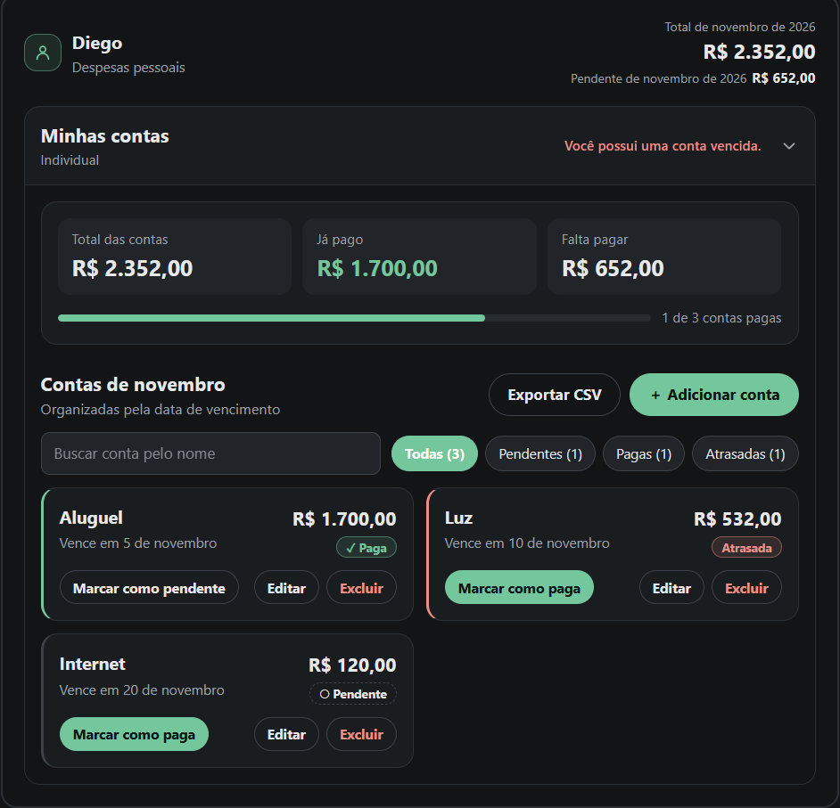
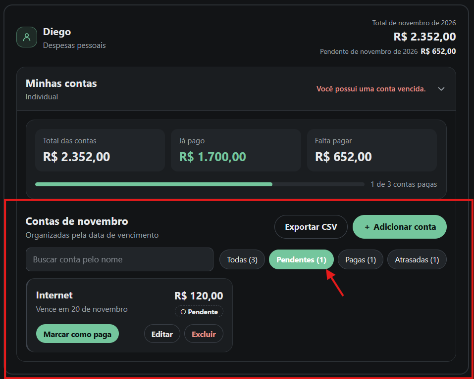

# Casos de teste: US-102 (Filtrar contas por situação)

**Ambiente:** develop @ 68721c9, Microsoft Edge 157.0.4341.60 (Compilação oficial) (64 bits), Windows 11.

## CT-102-01 — Filtro padrão: Todas

**Pré-condição:**

- A área Minhas contas deve possuir três contas cadastradas no mês.
- Uma conta deve estar paga e duas não pagas.

**Passos:**

1. Acessar a aplicação.
2. Expandir "Minhas contas".
3. Verificar se as quatro opções de filtro são exibidas.
4. Verificar qual opção está selecionada inicialmente.
5. Conferir a quantidade apresentada em cada opção.
6. Verificar se todas as contas são exibidas na lista.

**Dados de teste:**

- Conta 1: Aluguel — vencimento dia 5 — paga.
- Conta 2: Luz — vencimento dia 10 — não paga.
- Conta 3: Internet — vencimento dia 20 — não paga.
- Data de referência: dia 17 do mês.

**Resultado esperado:**

- As opções "Todas", "Pendentes", "Pagas" e "Atrasadas" devem ser exibidas acima da lista.
- A opção "Todas (3)" deve estar selecionada inicialmente.
- A opção "Pendentes (2)" deve ser exibida.
- A opção "Pagas (1)" deve ser exibida.
- A opção "Atrasadas (1)" deve ser exibida.
- As três contas devem aparecer na lista.

**Resultado obtido:**

- As opções "Todas", "Pendentes", "Pagas" e "Atrasadas" são exibidas acima da lista.
- A opção "Todas (3)" vem selecionada inicialmente.
- A opção "Pendentes (1)" é exibida.
- A opção "Pagas (1)" é exibida.
- A opção "Atrasadas (1)" é exibida.
- As três contas aparecem na lista.

**Situação:** Falhou — ver [BUG-002](../bugs/BUG-002.md)

**Evidência:**

**Reteste:** Passou em 18/11, commit 7184392 — ver [BUG-002](../bugs/BUG-002.md)

---

## CT-102-02 — Filtro Pendentes inclui contas atrasadas

**Pré-condição:**

- A área Minhas contas deve possuir contas não pagas com vencimentos anteriores e posteriores à data atual.

**Passos:**

1. Acessar a aplicação.
2. Expandir "Minhas contas".
3. Verificar se as contas "Luz" e "Internet" são exibidas.
4. Selecionar a opção "Pendentes".
5. Verificar quais contas permanecem na lista.
6. Conferir a quantidade apresentada no filtro.

**Dados de teste:**

- Conta 1: Aluguel — vencimento dia 5 — paga.
- Conta 2: Luz — vencimento dia 10 — não paga.
- Conta 3: Internet — vencimento dia 20 — não paga.
- Data de referência: dia 17 do mês.

**Resultado esperado:**

- Ao selecionar "Pendentes", devem ser exibidas as contas "Luz" e "Internet".
- A conta atrasada "Luz" também deve permanecer na lista, pois ainda não foi paga.
- A opção "Pendentes (2)" deve ser exibida.

**Resultado obtido:**

- Ao selecionar "Pendentes", apenas a conta "Internet" é exibida.
- A conta atrasada "Luz" não permanece na lista.
- A opção "Pendentes (1)" é exibida.

**Situação:** Falhou — ver [BUG-002](../bugs/BUG-002.md)

**Evidência:**

**Reteste:** Passou em 18/11, commit 7184392 — ver [BUG-002](../bugs/BUG-002.md)

---

## CT-102-03 — Filtro Atrasadas exibe somente contas não pagas com vencimento anterior à data atual

**Pré-condição:**

- A área Minhas contas deve possuir contas pagas, contas não pagas dentro do prazo e contas não pagas com vencimento anterior à data atual.

**Passos:**

1. Acessar a aplicação.
2. Expandir "Minhas contas".
3. Verificar se as contas cadastradas são exibidas.
4. Selecionar a opção "Atrasadas".
5. Verificar quais contas permanecem na lista.
6. Conferir a quantidade apresentada no filtro.

**Dados de teste:**

- Conta 1: Aluguel — vencimento dia 5 — paga.
- Conta 2: Luz — vencimento dia 10 — não paga.
- Conta 3: Internet — vencimento dia 20 — não paga.
- Data de referência: dia 17 do mês.

**Resultado esperado:**

- Somente a conta "Luz" deve ser exibida.
- A conta "Aluguel" não deve aparecer, pois está paga.
- A conta "Internet" não deve aparecer, pois ainda não venceu.
- A opção "Atrasadas (1)" deve ser exibida.

**Resultado obtido:**

- Somente a conta "Luz" é exibida.
- A conta "Aluguel" não é exibida.
- A conta "Internet" não é exibida.
- A opção "Atrasadas (1)" é exibida.

**Situação:** Passou.

**Evidência:**

[Assistir à gravação CT-102-03](../evidencias/CT-102-03.mp4)

---

## CT-102-04 — Filtro Pagas exibe somente contas marcadas como pagas

**Pré-condição:**

- A área Minhas contas deve possuir pelo menos uma conta paga e uma não paga.

**Passos:**

1. Acessar a aplicação.
2. Expandir "Minhas contas".
3. Verificar se as contas cadastradas são exibidas.
4. Selecionar a opção "Pagas".
5. Verificar quais contas permanecem na lista.
6. Conferir a quantidade apresentada no filtro.

**Dados de teste:**

- Conta 1: Aluguel — paga.
- Conta 2: Luz — não paga.
- Conta 3: Internet — não paga.

**Resultado esperado:**

- Somente a conta "Aluguel" deve ser exibida.
- As contas "Luz" e "Internet" não devem aparecer.
- A opção "Pagas (1)" deve ser exibida.

**Resultado obtido:**

- Somente a conta "Aluguel" é exibida.
- As contas "Luz" e "Internet" não são exibidas.
- A opção "Pagas (1)" é exibida.

**Situação:** Passou.

**Evidência:**

[Assistir à gravação CT-102-04](../evidencias/CT-102-04.mp4)

---

## CT-102-05 — Atualização dos filtros ao marcar uma conta como paga

**Pré-condição:**

- A área Minhas contas deve possuir pelo menos duas contas não pagas e uma conta paga.
- A conta "Internet" deve estar não paga.

**Passos:**

1. Acessar a aplicação.
2. Expandir "Minhas contas".
3. Selecionar a opção "Pendentes".
4. Verificar se as contas não pagas são exibidas.
5. Registrar os contadores apresentados nos filtros.
6. Marcar a conta "Internet" como paga.
7. Verificar se a conta "Internet" desaparece da lista.
8. Conferir se os contadores são atualizados imediatamente.
9. Selecionar a opção "Pagas".
10. Verificar se a conta "Internet" aparece na lista.

**Dados de teste:**

- Conta 1: Aluguel — paga.
- Conta 2: Luz — não paga e atrasada.
- Conta 3: Internet — não paga e dentro do prazo.

**Resultado esperado:**

- Antes de marcar "Internet" como paga, a opção "Pendentes (2)" deve ser exibida.
- Após marcar "Internet" como paga, a conta deve desaparecer imediatamente da lista de pendentes.
- O contador deve ser atualizado para "Pendentes (1)".
- O contador de pagas deve ser atualizado para "Pagas (2)".
- Ao selecionar "Pagas", as contas "Aluguel" e "Internet" devem ser exibidas.

**Resultado obtido:**

- Antes de marcar "Internet" como paga, a opção "Pendentes (1)" foi exibida.
- Após marcar "Internet" como paga, a conta desapareceu imediatamente.
- O contador foi atualizado para "Pendentes (0)".
- O contador de pagas foi atualizado para "Pagas (2)".
- Ao selecionar "Pagas", as contas "Aluguel" e "Internet" foram exibidas.

**Situação:** Falhou — ver [BUG-002](../bugs/BUG-002.md)

**Evidência:**

[Assistir à gravação CT-102-05](../evidencias/CT-102-05.mp4)

**Reteste:** Passou em 18/11, commit 7184392 — ver [BUG-002](../bugs/BUG-002.md)

---

## CT-102-06 — Atualização dos filtros ao desmarcar uma conta como paga

**Pré-condição:**

- A área Minhas contas deve possuir pelo menos duas contas pagas e uma conta não paga.
- A conta "Internet" deve estar marcada como paga.

**Passos:**

1. Acessar a aplicação.
2. Expandir "Minhas contas".
3. Selecionar a opção "Pagas".
4. Verificar se a conta "Internet" é exibida.
5. Desmarcar a conta "Internet" como paga.
6. Verificar se a conta desaparece imediatamente da lista de pagas.
7. Conferir se os contadores são atualizados.
8. Selecionar a opção "Pendentes".
9. Verificar se a conta "Internet" aparece na lista.

**Dados de teste:**

- Conta 1: Aluguel — paga.
- Conta 2: Luz — não paga e atrasada.
- Conta 3: Internet — paga e com vencimento posterior à data atual.

**Resultado esperado:**

- Antes de desmarcar "Internet", a opção "Pagas (2)" deve ser exibida.
- Após desmarcar a conta, ela deve desaparecer imediatamente da lista de pagas.
- O contador deve ser atualizado para "Pagas (1)".
- O contador de pendentes deve ser atualizado para "Pendentes (2)".
- Ao selecionar "Pendentes", as contas "Luz" e "Internet" devem ser exibidas.

**Resultado obtido:**

- Antes de desmarcar "Internet", a opção "Pagas (2)" é exibida.
- Após desmarcar a conta, ela desaparece imediatamente da lista de pagas.
- O contador é atualizado para "Pagas (1)".
- O contador de pendentes exibe "Pendentes (1)".
- Ao selecionar "Pendentes", a conta "Internet" é exibida e a conta "Luz" não é exibida.

**Situação:** Falhou — ver [BUG-002](../bugs/BUG-002.md)

**Evidência:**

[Assistir à gravação CT-102-06](../evidencias/CT-102-06.mp4)

**Reteste:** Passou em 18/11, commit 7184392 — ver [BUG-002](../bugs/BUG-002.md)

---

## CT-102-07 — Filtro de situação funcionando junto com a busca

**Pré-condição:**

- A área Minhas contas deve possuir as contas "Internet", "Luz" e "Aluguel" cadastradas.
- A busca pelo nome da conta deve estar disponível.

**Passos:**

1. Acessar a aplicação.
2. Expandir "Minhas contas".
3. Selecionar a opção "Pendentes".
4. Clicar em "Buscar conta pelo nome".
5. Digitar "inter" no campo de busca.
6. Verificar quais contas permanecem na lista.
7. Conferir a quantidade apresentada nos filtros.
8. Verificar se a opção "Pendentes" continua selecionada.

**Dados de teste:**

- Conta 1: Internet — não paga.
- Conta 2: Luz — não paga.
- Conta 3: Aluguel — paga.
- Termo de busca: "inter".

**Resultado esperado:**

- A busca deve funcionar em conjunto com o filtro "Pendentes".
- Somente a conta "Internet" deve ser exibida.
- A opção "Pendentes" deve continuar selecionada.
- A opção "Todas (1)" deve ser exibida, considerando somente as contas correspondentes ao texto buscado.
- Os demais contadores também devem considerar o resultado da busca.

**Resultado obtido:**

- A busca funcionou em conjunto com o filtro "Pendentes".
- Somente a conta "Internet" foi exibida.
- A opção "Pendentes" continuou selecionada.
- A opção "Todas (1)" foi exibida.
- Os demais contadores consideraram o resultado da busca: "Pendentes (1)", "Pagas (0)" e "Atrasadas (0)".

**Situação:** Passou.

**Evidência:**

[Assistir à gravação CT-102-07](../evidencias/CT-102-07.mp4)

---

## CT-102-08 — Contadores consideram o texto informado na busca

**Pré-condição:**

- A área Minhas contas deve possuir contas com diferentes situações.
- A busca pelo nome da conta deve estar disponível.

**Passos:**

1. Acessar a aplicação.
2. Expandir "Minhas contas".
3. Digitar "inter" no campo "Buscar conta pelo nome".
4. Verificar quais contas correspondem ao texto informado.
5. Conferir os contadores apresentados nas quatro opções de filtro.
6. Selecionar "Pendentes".
7. Verificar se a lista e os contadores continuam considerando o texto buscado.

**Dados de teste:**

- Conta 1: Internet — não paga.
- Conta 2: Interfone — paga.
- Conta 3: Luz — não paga.
- Conta 4: Aluguel — paga.
- Termo de busca: "inter".

**Resultado esperado:**

- A busca deve considerar somente as contas cujos nomes correspondem ao texto "inter".
- A opção "Todas (2)" deve ser exibida.
- A opção "Pendentes (1)" deve ser exibida.
- A opção "Pagas (1)" deve ser exibida.
- A opção "Atrasadas" deve apresentar a quantidade correspondente às contas encontradas que estejam atrasadas.
- Ao selecionar "Pendentes", somente a conta "Internet" deve ser exibida.

**Resultado obtido:**

- A busca exibe somente as contas cujos nomes correspondem ao texto "inter".
- A opção "Todas (2)" é exibida.
- A opção "Pendentes (1)" é exibida.
- A opção "Pagas (1)" é exibida.
- A opção de contas atrasadas exibe: "Atrasadas (0)".
- Ao selecionar "Pendentes", somente a conta "Internet" é exibida.

**Situação:** Passou.

**Evidência:**

[Assistir à gravação CT-102-08](../evidencias/CT-102-08.mp4)
