# Casos de teste: US-103 (Exportar as contas do mês em CSV)

**Ambiente:** develop @ 68721c9, Microsoft Edge 157.0.4341.60 (Compilação oficial) (64 bits), Windows 11. Planilha: Microsoft Excel Online, em português (o Excel instalado não foi testado).

## CT-103-01 — Exportar todas as contas do mês

**Pré-condição:**

- A área "Gastos da casa" deve possuir pelo menos três contas cadastradas no mês de novembro de 2026.

**Passos:**

1. Acessar a aplicação.
2. Navegar até novembro de 2026.
3. Expandir a área "Gastos da casa".
4. Verificar se as contas cadastradas são exibidas.
5. Clicar no botão "Exportar CSV".
6. Verificar se o arquivo foi baixado.
7. Abrir o arquivo e conferir seu conteúdo.

**Dados de teste:**

- Área: Gastos da casa.
- Mês: novembro de 2026.
- Conta 1: Aluguel.
- Conta 2: Água.
- Conta 3: Internet.

**Resultado esperado:**

- O arquivo deve ser baixado com o nome `gastos-gastos-da-casa-2026-11.csv`.
- O arquivo deve possuir uma linha de cabeçalho e uma linha para cada conta cadastrada no mês.
- As colunas devem ser separadas por ponto e vírgula.
- O cabeçalho deve apresentar as colunas `Nome;Vencimento;Valor;Situação`.

**Resultado obtido:**

- O arquivo baixado tem o nome `gastos-gastos-da-casa-2026-11.csv`.
- O arquivo possui uma linha de cabeçalho e uma linha para cada conta cadastrada no mês.
- As colunas são separadas por ponto e vírgula.
- O cabeçalho apresenta as colunas `Nome;Vencimento;Valor;Situação`.

**Situação:** Passou.

**Evidência:**

[Assistir à gravação CT-103-01](../evidencias/CT-103-01a.mp4)

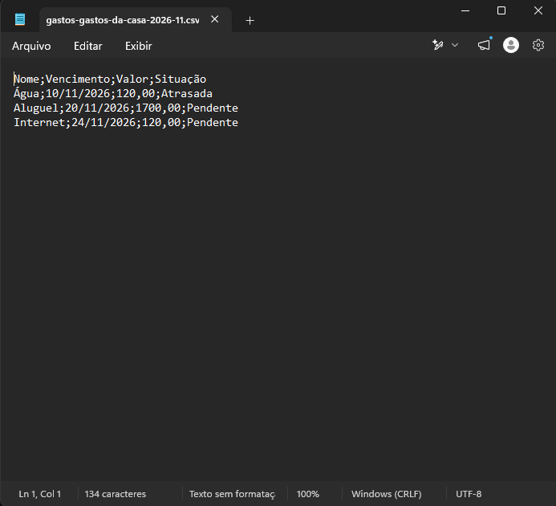

---

## CT-103-02 — Verificar o nome do arquivo com áreas que possuem espaços e acentos

**Pré-condição:**

- A aplicação deve possuir uma área com nome composto e acentuado.
- A área deve possuir pelo menos uma conta cadastrada no mês.

**Passos:**

1. Acessar a aplicação.
2. Expandir a área "Gastos da casa".
3. Clicar no botão "Exportar CSV".
4. Verificar o nome do arquivo baixado.

**Dados de teste:**

- Nome da área: Gastos da casa.
- Mês: novembro de 2026.

**Resultado esperado:**

O arquivo deve ser baixado com o nome `gastos-gastos-da-casa-2026-11.csv`, utilizando letras minúsculas, sem acentos e com hífens no lugar dos espaços.

**Resultado obtido:**

O arquivo baixado exibe o nome `gastos-gastos-da-casa-2026-11.csv`, utilizando letras minúsculas, sem acentos e com hífens no lugar dos espaços.

**Situação:** Passou.

**Evidência:**

[Assistir à gravação CT-103-02](../evidencias/CT-103-02a.mp4)

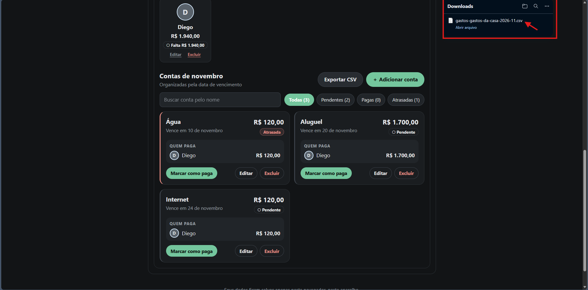

---

## CT-103-03 — Exportar todas as contas independentemente do filtro selecionado

**Pré-condição:**

- A área "Gastos da casa" deve possuir contas com diferentes situações.
- O filtro "Pagas" deve estar disponível.

**Passos:**

1. Acessar a aplicação.
2. Expandir "Gastos da casa".
3. Selecionar o filtro "Pagas".
4. Verificar se somente as contas pagas são exibidas na tela.
5. Clicar em "Exportar CSV".
6. Abrir o arquivo baixado.
7. Conferir se todas as contas do mês estão presentes, independentemente da situação.

**Dados de teste:**

- Conta 1: Aluguel — paga.
- Conta 2: Água — pendente.
- Conta 3: Internet — atrasada.

**Resultado esperado:**

O arquivo CSV deve conter todas as contas cadastradas no mês, incluindo "Aluguel", "Água" e "Internet", mesmo que o filtro "Pagas" esteja selecionado na tela.

**Resultado obtido:**

O arquivo CSV contém todas as contas cadastradas no mês, incluindo "Aluguel", "Água" e "Internet", mesmo que o filtro "Pagas" esteja selecionado na tela.

**Situação:** Passou.

**Evidência:**

[Assistir à gravação CT-103-03](../evidencias/CT-103-03a.mp4)

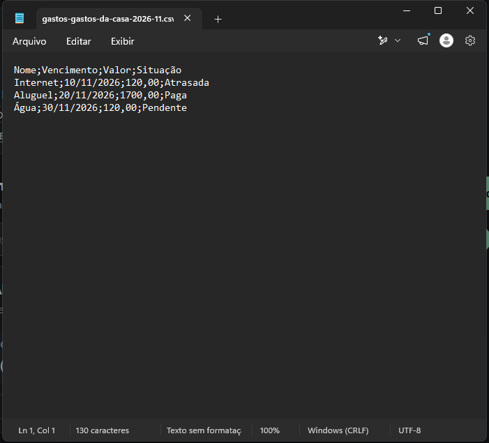

---

## CT-103-04 — Exportar todas as contas independentemente do texto da busca

**Pré-condição:**

- A área "Gastos da casa" deve possuir pelo menos três contas cadastradas no mês.
- A busca pelo nome da conta deve estar disponível.

**Passos:**

1. Acessar a aplicação.
2. Expandir "Gastos da casa".
3. Digitar "inter" no campo de busca.
4. Verificar se somente as contas correspondentes ao texto são exibidas.
5. Clicar em "Exportar CSV".
6. Abrir o arquivo baixado.
7. Conferir se todas as contas cadastradas no mês estão presentes.

**Dados de teste:**

- Conta 1: Internet.
- Conta 2: Interfone.
- Conta 3: Água.
- Termo de busca: "inter".

**Resultado esperado:**

O arquivo CSV deve conter todas as contas cadastradas no mês, independentemente do texto informado na busca.

**Resultado obtido:**

O arquivo CSV baixado contém todas as contas cadastradas no mês, independentemente do texto informado na busca.

**Situação:** Passou.

**Evidência:**

[Assistir à gravação CT-103-04](../evidencias/CT-103-04a.mp4)

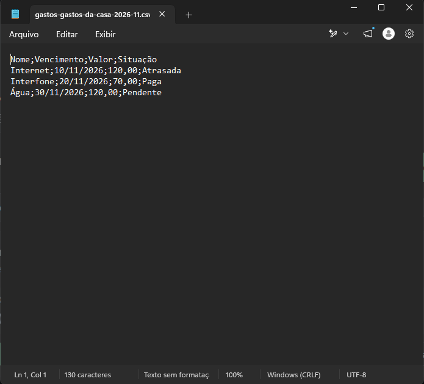

---

## CT-103-05 — Verificar a ordem das contas no arquivo exportado

**Pré-condição:**

- A área "Gastos da casa" deve possuir pelo menos três contas com vencimentos diferentes no mês.

**Passos:**

1. Acessar a aplicação.
2. Expandir "Gastos da casa".
3. Verificar a ordem das contas exibidas na tela.
4. Clicar em "Exportar CSV".
5. Abrir o arquivo baixado.
6. Comparar a ordem das contas no arquivo com a ordem apresentada na tela.

**Dados de teste:**

- Conta 1: Internet — vencimento dia 20.
- Conta 2: Aluguel — vencimento dia 5.
- Conta 3: Água — vencimento dia 10.

**Resultado esperado:**

As contas devem ser exportadas na mesma ordem apresentada na tela, considerando a ordenação por vencimento:

1. Aluguel.
2. Água.
3. Internet.

**Resultado obtido:**

As contas exportadas respeitam a mesma ordem exibida na tela.

1. Aluguel.
2. Água.
3. Internet.

**Situação:** Passou.

**Evidência:**

[Assistir à gravação CT-103-05](../evidencias/CT-103-05a.mp4)

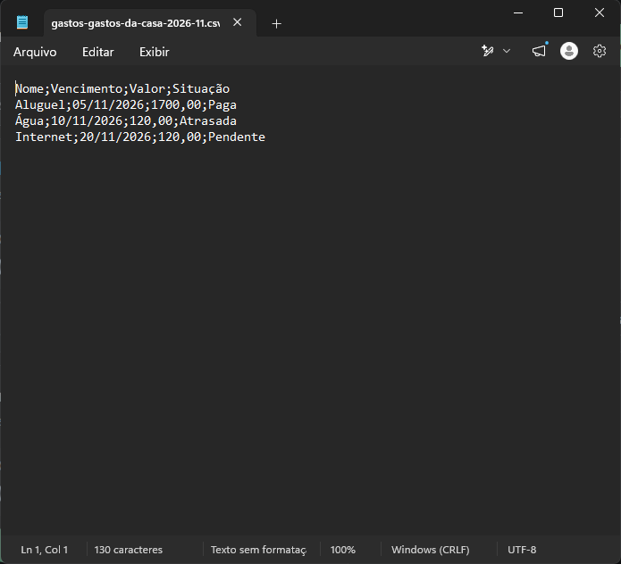

---

## CT-103-06 — Verificar o formato do vencimento no arquivo CSV

**Pré-condição:**

- A área "Gastos da casa" deve possuir contas cadastradas no mês de novembro de 2026.
- Uma das contas deve possuir vencimento no dia 31.

**Passos:**

1. Acessar a aplicação.
2. Navegar até novembro de 2026.
3. Expandir "Gastos da casa".
4. Localizar a conta "Cartão".
5. Verificar a data de vencimento apresentada na tela.
6. Clicar em "Exportar CSV".
7. Abrir o arquivo baixado.
8. Verificar a data de vencimento da conta "Cartão".

**Dados de teste:**

- Conta: Cartão.
- Mês: novembro de 2026.
- Dia de vencimento cadastrado: 31.

**Resultado esperado:**

O vencimento deve ser apresentado no formato `DD/MM/AAAA`, respeitando a data efetiva mostrada na tela.

Para a conta "Cartão", o vencimento deve ser `30/11/2026`, pois novembro possui 30 dias.

**Resultado obtido:**

O vencimento apresenta o formato `DD/MM/AAAA`, mas não respeita a data efetiva mostrada na tela.

Para a conta "Cartão", o vencimento exibe a data de `31/11/2026`, enquanto a tela mostra "Vence em 30 de novembro".

Variação: em fevereiro de 2027, uma conta com vencimento no dia 31 aparece na tela como "Vence em 28 de fevereiro", mas no CSV sai como `31/02/2027`.

**Situação:** Falhou — ver [BUG-003](../bugs/BUG-003.md)

**Evidência:**

[Assistir à gravação CT-103-06](../evidencias/CT-103-06a.mp4)

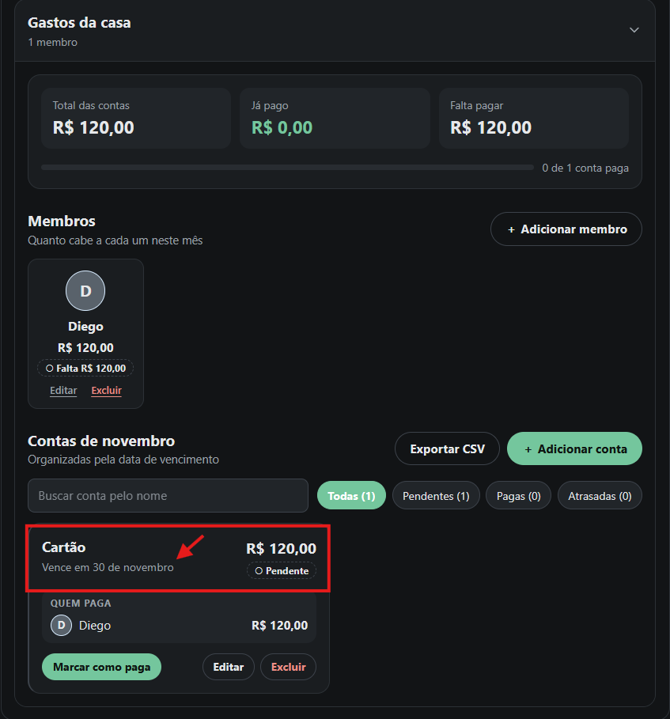

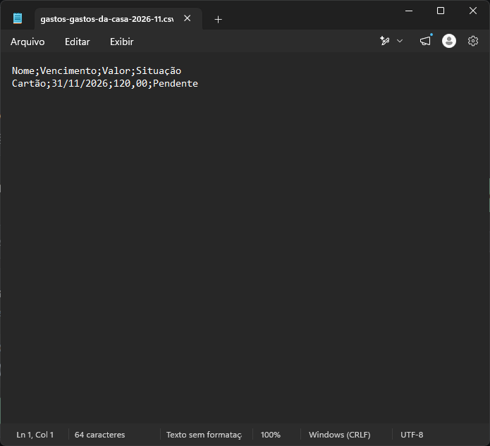


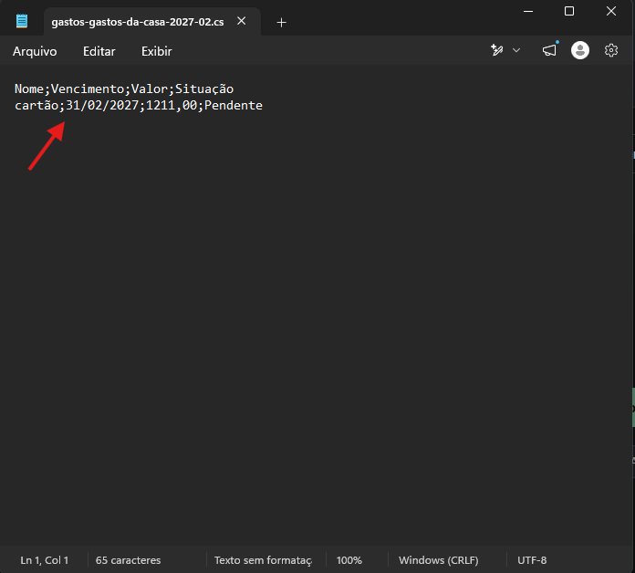

**Reteste:** Passou em 18/11, commit 42dd2fa — ver [BUG-003](../bugs/BUG-003.md)

---

## CT-103-07 — Verificar o formato dos valores no arquivo CSV

**Pré-condição:**

- A área "Gastos da casa" deve possuir contas com valores conhecidos cadastradas no mês.

**Passos:**

1. Acessar a aplicação.
2. Expandir "Gastos da casa".
3. Clicar em "Exportar CSV".
4. Abrir o arquivo baixado.
5. Verificar os valores exportados.
6. Conferir se os valores estão sem o símbolo "R$", sem separador de milhar e com vírgula decimal.

**Dados de teste:**

- Conta 1: Água — R$ 150,00.
- Conta 2: Aluguel — R$ 1.500,00.
- Conta 3: Internet — R$ 99,90.

**Resultado esperado:**

Os valores devem ser exportados sem o símbolo "R$", sem ponto de milhar e com vírgula decimal.

Exemplo:

- Água: `150,00`.
- Aluguel: `1500,00`.
- Internet: `99,90`.

**Resultado obtido:**

Os valores são exportados sem o símbolo "R$", sem ponto de milhar e com vírgula decimal:

```
Nome;Vencimento;Valor;Situação
Água;10/11/2026;150,00;Paga
Aluguel;10/11/2026;1500,00;Paga
Internet;10/11/2026;99,90;Paga
```

**Situação:** Passou.

**Evidência:**

[Assistir à gravação CT-103-07](../evidencias/CT-103-07a.mp4)

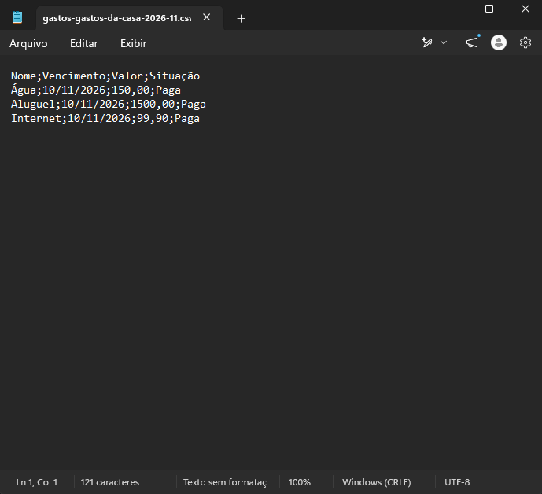

---

## CT-103-08 — Verificar a situação das contas no arquivo CSV

**Pré-condição:**

- A área "Gastos da casa" deve possuir contas pagas, pendentes e atrasadas.

**Passos:**

1. Acessar a aplicação.
2. Expandir "Gastos da casa".
3. Verificar a situação apresentada nos cartões das contas.
4. Clicar em "Exportar CSV".
5. Abrir o arquivo baixado.
6. Conferir se a situação de cada conta corresponde à apresentada na tela.

**Dados de teste:**

- Conta 1: Aluguel — paga.
- Conta 2: Internet — pendente e dentro do prazo.
- Conta 3: Água — atrasada e não paga.

**Resultado esperado:**

A coluna "Situação" deve apresentar os seguintes valores:

- Aluguel: `Paga`.
- Internet: `Pendente`.
- Água: `Atrasada`.

As situações exportadas devem corresponder às apresentadas nos cartões das contas.

**Resultado obtido:**

A coluna "Situação" apresenta os seguintes valores:

```
Nome;Vencimento;Valor;Situação
Água;10/11/2026;150,00;Atrasada
Aluguel;10/11/2026;1500,00;Paga
Internet;25/11/2026;99,90;Pendente
```

As situações exportadas correspondem às apresentadas nos cartões das contas.

**Situação:** Passou.

**Evidência:**

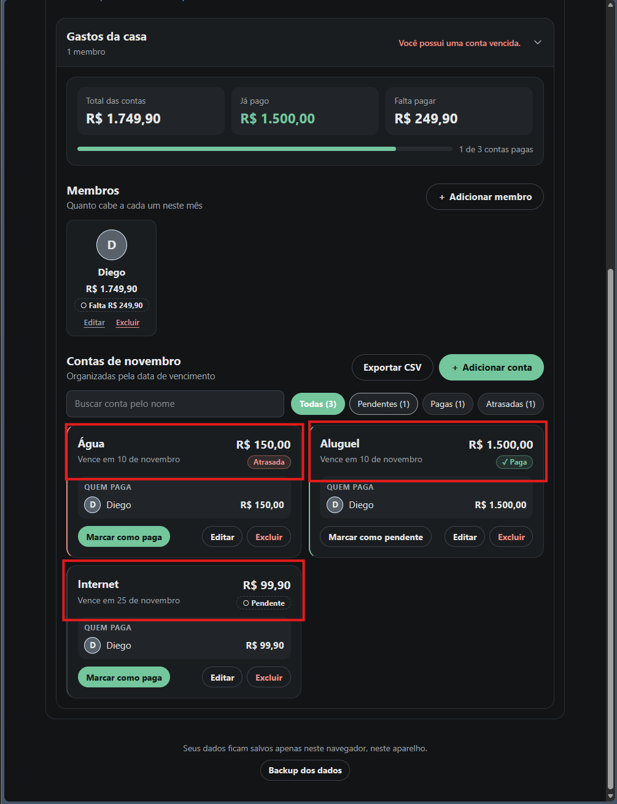

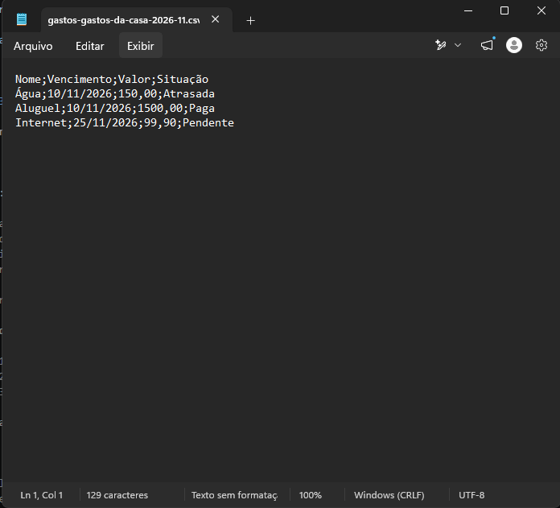

---

## CT-103-09 — Verificar a abertura do CSV no Excel Online em português

**Pré-condição:**

- A área "Gastos da casa" deve possuir contas cadastradas com nomes que contenham acentos.
- Acesso ao Microsoft Excel Online pelo navegador, com o idioma em português.
- **Desvio do plano:** o Excel instalado não está disponível na máquina de teste. A abertura com duplo clique no Excel instalado não será testada nesta sprint.

**Passos:**

1. Acessar a aplicação.
2. Expandir "Gastos da casa".
3. Clicar em "Exportar CSV".
4. Localizar o arquivo baixado.
5. Abrir o Excel Online no navegador, carregar o arquivo baixado e abri-lo.
6. Verificar se as colunas são separadas corretamente.
7. Conferir se os nomes e cabeçalhos com acentos são exibidos corretamente.

**Dados de teste:**

- Conta 1: Água.
- Conta 2: Condomínio.
- Conta 3: Farmácia.
- Cabeçalho: Situação.

**Resultado esperado:**

Ao abrir o arquivo no Excel Online em português:

- As colunas "Nome", "Vencimento", "Valor" e "Situação" devem ser separadas corretamente.
- Os acentos devem ser exibidos corretamente, incluindo "Água", "Condomínio", "Situação" e "Farmácia".
- Os dados não devem ficar agrupados em uma única coluna.

**Resultado obtido:**

- As colunas "Nome", "Vencimento", "Valor" e "Situação" são separadas corretamente.
- Os acentos não são exibidos corretamente:
  - "Água" aparece como "Ã�gua".
  - "Condomínio" aparece como "Condomínio".
  - "Farmácia" aparece como "Farmácia".
  - "Situação" aparece como "Situação".
- Os dados não ficam agrupados em uma única coluna.

**Situação:** Falhou — ver [BUG-004](../bugs/BUG-004.md)

**Evidência:**

[Exportação do CSV](../evidencias/CT-103-09a.mp4)

[Abertura no Excel Online](../evidencias/CT-103-09b.mp4)

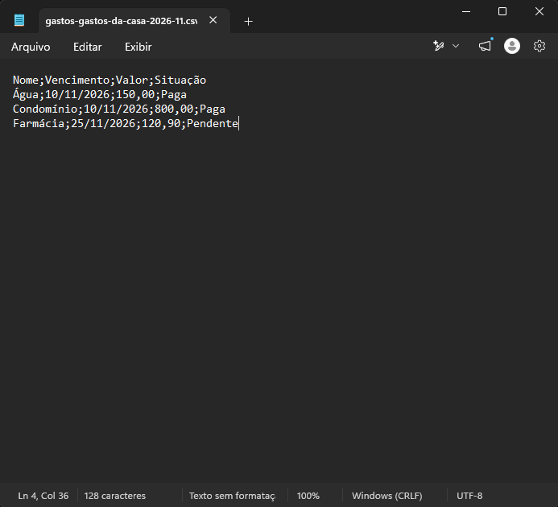

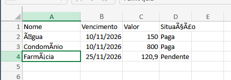

---

## CT-103-10 — Exportar contas com nomes que possuem ponto e vírgula ou aspas

**Pré-condição:**

- A área "Gastos da casa" deve permitir cadastrar nomes de contas com ponto e vírgula e aspas.
- A área deve possuir contas com esses caracteres cadastradas no mês.

**Passos:**

1. Acessar a aplicação.
2. Expandir "Gastos da casa".
3. Verificar se as contas cadastradas são exibidas.
4. Clicar em "Exportar CSV".
5. Abrir o arquivo baixado.
6. Conferir se os nomes das contas estão completos.
7. Verificar se os caracteres especiais não causaram deslocamento dos dados entre as colunas.
8. Abrir o arquivo com o Bloco de Notas para comparação.

**Dados de teste:**

- Conta 1: Água; Condominio.
- Conta 2: Conta "Especial".
- Conta 3: Internet.

**Resultado esperado:**

- Os nomes das contas devem ser exportados corretamente.
- O ponto e vírgula e as aspas não devem quebrar a estrutura do CSV.
- Os dados de vencimento, valor e situação devem permanecer em suas respectivas colunas.

**Resultado obtido:**

- Os nomes "Água; Condominio.", "Conta "Especial"" e "Internet" são exportados completos, sem cortes.
- No Excel Online, "Conta "Especial"" e "Internet" aparecem corretos, mas "Água" aparece como "Ã�gua" e o cabeçalho "Situação" como "Situação" (mesmo comportamento do BUG-004).
- O ponto e vírgula e as aspas não quebram a estrutura do CSV.
- Os dados de vencimento, valor e situação permanecem em suas respectivas colunas.

**Situação:** Falhou — ver [BUG-004](../bugs/BUG-004.md)

**Evidência:**

[Exportação do CSV](../evidencias/CT-103-10a.mp4)

[Abertura no Excel Online](../evidencias/CT-103-10b.mp4)

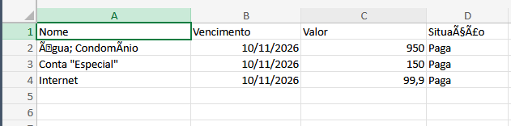

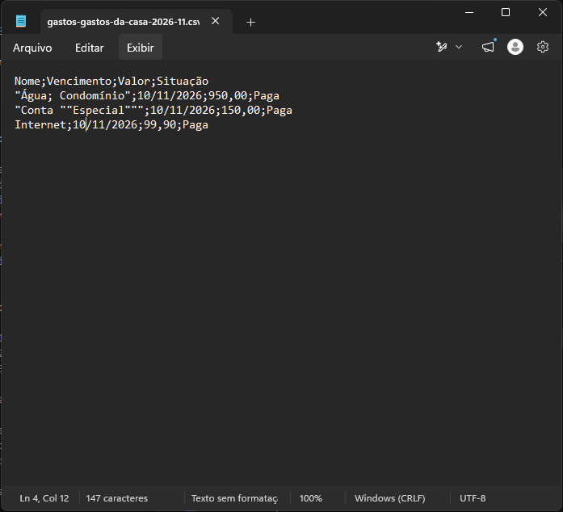

---

## CT-103-11 — Botão Exportar CSV desabilitado quando o mês não possui contas

**Pré-condição:**

- O mês selecionado não deve possuir contas cadastradas na área "Minhas contas".

**Passos:**

1. Acessar a aplicação.
2. Expandir "Minhas contas".
3. Navegar até um mês sem contas cadastradas.
4. Verificar se o botão "Exportar CSV" está disponível.
5. Verificar se é possível clicar no botão.

**Dados de teste:**

- Área: Minhas contas.
- Mês: janeiro de 2027.

**Resultado esperado:**

Quando o mês selecionado não possuir contas cadastradas, o botão "Exportar CSV" deve permanecer desabilitado, impedindo a exportação.

**Resultado obtido:**

Ao navegar para janeiro de 2027 (mês sem contas cadastradas), o botão "Exportar CSV" permanece desabilitado, impedindo a exportação.
Ao passar o mouse sobre o botão, o cursor indica que a ação não é permitida, e nenhum arquivo é baixado.
Ao clicar no botão, nada acontece e nenhum arquivo é baixado.

**Situação:** Passou.

**Evidência:**

[Botão "Exportar CSV" desabilitado](../evidencias/CT-103-11.mp4)
