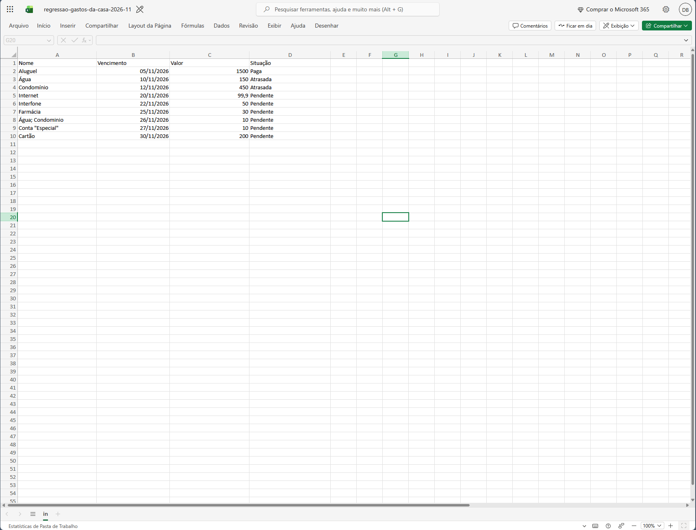

# Regressão: Sprint 1

**Ambiente:** develop @ 877a466, navegador integrado do aplicativo Claude (Chromium 156), Windows 11.

**Data:** 18/11/2026.

**Executada por:** Claude (assistente de IA), a pedido do QA. Os casos de teste, o escopo e os critérios são os definidos pelo QA neste repositório. A abertura do CSV no Excel Online (CT-103-09 e CT-103-10) foi feita pelo QA.

## Objetivo

Confirmar que as correções dos BUG-001 a BUG-005 não quebraram o que já funcionava, na versão com todas as correções juntas.

O commit `877a466` tem o mesmo código do `b7903de` (merge do BUG-005); o commit seguinte só alterou a documentação.

## Escopo

- Reexecução dos casos de teste das quatro histórias da sprint, porque cada correção alterou uma delas:
  - US-101: BUG-001;
  - US-102: BUG-002;
  - US-103: BUG-003 e BUG-004;
  - US-104: BUG-005.
- Casos que ficaram para a regressão nos retestes:
  - CT-102-03, 04, 07 e 08;
  - CT-103-10;
  - CT-104-01, 02, 07, 08 e 10.
- Regressão da versão 1.0, conforme a seção 3 do [plano de teste](plano-de-teste.md).
- Busca, filtro e "Exportar CSV" na largura de celular (375 px).

**Fora do escopo desta execução:**

- Microsoft Edge 157 e Firefox.
- Testes exploratórios.

## Preparação

- Para cada história, as contas dos dados de teste foram cadastradas antes da execução, com os mesmos nomes, valores, vencimentos e situações descritos nos casos.
- Todos os passos foram feitos pela tela: buscar, filtrar, marcar como paga, criar, editar, excluir, exportar e restaurar.
- O backup do CT-104-10 foi gerado pela própria aplicação e editado manualmente no JSON, como descreve a pré-condição do caso.
- Ao final, os dados originais do navegador foram restaurados.

---

## Casos de teste da sprint

### US-101: Busca de contas

| CT | Título | Situação | Observação |
| --- | --- | --- | --- |
| CT-101-01 | Busca por parte do nome | Passou. | "net" exibe somente "Internet". |
| CT-101-02 | Busca sem diferenciar maiúsculas | Passou. | "INTERNET" exibe "Internet". |
| CT-101-03 | Busca sem diferenciar acentos | Passou. | "agua" exibe "Água" e "condominio" exibe "Condomínio". |
| CT-101-04 | Busca sem resultado | Passou. | "xyz" exibe "Nenhuma conta encontrada" e o botão "Limpar busca e filtro", que traz a lista completa de volta. |
| CT-101-05 | Mês sem contas | Passou. | Em outubro de 2026 o campo de busca não é exibido. |
| CT-101-06 | O campo aceita até 50 caracteres | Passou. | 49 e 50 caracteres são aceitos; o 51º não é adicionado. |
| CT-101-07 | Busca mantém os resumos financeiros | Passou. | Os resumos continuam iguais nas duas áreas: R$ 2.050,00 e R$ 2.750,00. |
| CT-101-08 | Espaços no começo e no fim são ignorados | Passou. | "  net  " exibe somente "Internet". |
| CT-101-09 | Cada área tem a sua própria busca | Passou. | A busca em uma área não altera a lista da outra. |

### US-102: Filtro por situação

| CT | Título | Situação | Observação |
| --- | --- | --- | --- |
| CT-102-01 | Filtro padrão: Todas | Passou. | "Todas (3)" selecionada; "Pendentes (2)", "Pagas (1)" e "Atrasadas (1)". |
| CT-102-02 | Filtro Pendentes inclui contas atrasadas | Passou. | "Pendentes" exibe "Luz", que está atrasada, e "Internet". |
| CT-102-03 | Filtro Atrasadas | Passou. | Exibe somente "Luz". |
| CT-102-04 | Filtro Pagas | Passou. | Exibe somente "Aluguel". |
| CT-102-05 | Atualização ao marcar como paga | Passou. | "Internet" sai da lista na hora; "Pendentes (1)" e "Pagas (2)". |
| CT-102-06 | Atualização ao desmarcar como paga | Passou. | "Internet" sai da lista na hora; "Pagas (1)" e "Pendentes (2)". |
| CT-102-07 | Filtro junto com a busca | Passou. | Com "Pendentes" e "inter", exibe somente "Internet"; o filtro continua selecionado e aparece "Todas (1)". |
| CT-102-08 | Contadores consideram a busca | Passou. | "inter" exibe "Internet" e "Interfone"; "Todas (2)", "Pendentes (1)", "Pagas (1)" e "Atrasadas (0)". |

### US-103: Exportar CSV

| CT | Título | Situação | Observação |
| --- | --- | --- | --- |
| CT-103-01 | Exportar todas as contas do mês | Passou. | Arquivo `gastos-gastos-da-casa-2026-11.csv` com cabeçalho e uma linha por conta. |
| CT-103-02 | Nome do arquivo com espaços e acentos | Passou. | Nome em minúsculas, sem acentos e com hífens. |
| CT-103-03 | Exportar independentemente do filtro | Passou. | Com o filtro "Pagas", o arquivo tem todas as contas do mês. |
| CT-103-04 | Exportar independentemente da busca | Passou. | Com a busca "inter", o arquivo tem todas as contas do mês. |
| CT-103-05 | Ordem das contas no arquivo | Passou. | Mesma ordem da tela: Aluguel, Água, Internet. |
| CT-103-06 | Formato do vencimento | Passou. | "Cartão" com dia 31 sai como `30/11/2026`, igual à tela. |
| CT-103-07 | Formato dos valores | Passou. | `1500,00`, `150,00` e `99,90`. |
| CT-103-08 | Situação das contas | Passou. | `Paga`, `Atrasada` e `Pendente`, iguais aos cartões. |
| CT-103-09 | Abertura no Excel Online | Passou. | As colunas ficam separadas e os acentos aparecem corretos: "Água", "Condomínio", "Farmácia", "Cartão" e "Situação". |
| CT-103-10 | Nomes com ponto e vírgula ou aspas | Passou. | No Excel Online, "Água; Condominio" e "Conta "Especial"" aparecem completos na coluna Nome, e as outras colunas ficam no lugar. |
| CT-103-11 | Botão desabilitado em mês sem contas | Passou. | Em janeiro de 2027 o botão fica desabilitado e nada é baixado. |

**Evidência:**

[Gastos da casa: arquivo CSV exportado](evidencias/regressao-gastos-da-casa-2026-11.csv)

### US-104: Limite de valor

| CT | Título | Situação | Observação |
| --- | --- | --- | --- |
| CT-104-01 | Valor imediatamente abaixo do limite | Passou. | R$ 999.999,99 é salvo. |
| CT-104-02 | Valor exatamente igual ao limite | Passou. | R$ 1.000.000,00 é salvo. |
| CT-104-03 | Valor acima do limite | Passou. | R$ 1.000.000,01 exibe a mensagem de valor máximo e não é salvo. |
| CT-104-04 | Valor muito acima do limite | Passou. | R$ 2.000.000,00 exibe a mensagem e não é salvo. |
| CT-104-05 | Edição para valor acima do limite | Passou. | A mensagem é exibida e a conta continua com R$ 150,00. |
| CT-104-06 | Limite em diferentes áreas | Passou. | Também em "Gastos da casa" a mensagem é exibida e nada é salvo. |
| CT-104-07 | Limite em contas recorrentes | Passou. | A mensagem é exibida e a conta recorrente não é criada. |
| CT-104-08 | Limite em contas parceladas | Passou. | A mensagem é exibida e a conta parcelada não é criada. |
| CT-104-09 | Limite na edição de recorrentes e parceladas | Passou. | A mensagem é exibida e as duas contas continuam com R$ 100,00. |
| CT-104-10 | Restaurar backup antigo acima do limite | Passou. | O backup é restaurado e a conta aparece com R$ 1.500.000,00. |

**Evidência:**

[Minhas contas: criação com R$ 1.000.000,01](evidencias/regressao-CT-104-03.jpg)

[Gastos da casa: criação com R$ 1.000.000,01](evidencias/regressao-CT-104-06-gastos-da-casa.jpg)

[Minhas contas: criação de conta parcelada com R$ 1.000.000,01](evidencias/regressao-CT-104-08.jpg)

[Restauração do backup](evidencias/regressao-CT-104-10.jpg)

---

## Regressão da versão 1.0

## REG-01 — Criar, editar e excluir uma conta

**Pré-condição:**

- A área "Gastos da casa" deve estar disponível.

**Passos:**

1. Acessar a aplicação.
2. Expandir "Gastos da casa".
3. Criar a conta "Internet" de R$ 100,00, dividida igualmente entre Eu, Mãe e Padrasto.
4. Editar a conta "Internet" e alterar o valor para R$ 120,00.
5. Excluir a conta "Aluguel" (criada no REG-04) e confirmar a exclusão.

**Resultado esperado:**

- A conta deve ser criada e exibida na lista.
- A edição deve ser salva e a divisão recalculada.
- A conta excluída deve sair da lista e os totais devem ser atualizados.

**Resultado obtido:**

- A conta "Internet" é criada e exibida na lista.
- Após a edição, a conta passa a R$ 120,00 e a divisão fica R$ 40,00 para cada pessoa.
- Ao excluir, a aplicação pede confirmação. Após confirmar, "Aluguel" sai da lista e os totais de cada pessoa são atualizados.

**Situação:** Passou.

---

## REG-02 — Marcar e desmarcar uma conta como paga

**Resultado obtido:**

Coberto pelos CT-102-05 e CT-102-06: a conta muda de situação na hora e os contadores e o "Já pago" são atualizados.

**Situação:** Passou.

---

## REG-03 — Divisão igual entre as pessoas

**Pré-condição:**

- A área "Gastos da casa" deve possuir integrantes.

**Passos:**

1. Iniciar a criação de uma conta em "Gastos da casa".
2. Informar o valor de R$ 100,00.
3. Escolher Eu, Mãe e Padrasto em "Quem vai pagar?".
4. Manter "Dividir igualmente".
5. Salvar a conta.

**Resultado esperado:**

O valor deve ser dividido entre as três pessoas, sem perder centavos.

**Resultado obtido:**

A divisão fica R$ 33,34 + R$ 33,33 + R$ 33,33 = R$ 100,00.

**Situação:** Passou.

---

## REG-04 — Divisão com valores personalizados

**Passos:**

1. Iniciar a criação da conta "Aluguel" de R$ 100,00 em "Gastos da casa".
2. Escolher Eu e Mãe em "Quem vai pagar?".
3. Selecionar "Escolher valores".
4. Informar R$ 70,00 para Eu e manter R$ 50,00 para Mãe.
5. Alterar o valor de Mãe para R$ 30,00.
6. Salvar a conta.

**Resultado esperado:**

- Com a soma diferente do total, deve ser exibido um aviso.
- Com a soma igual ao total, a conta deve ser salva com os valores escolhidos.

**Resultado obtido:**

- Com R$ 70,00 + R$ 50,00, aparece "A soma passou R$ 20,00 do total de R$ 100,00.".
- Com R$ 70,00 + R$ 30,00, aparece "Tudo certo, a soma fecha com o total." e a conta é salva com esses valores.

**Situação:** Passou.

**Evidência:**

[Gastos da casa: soma das partes acima do total](evidencias/regressao-divisao-soma-errada.jpg)

[Gastos da casa: contas com divisão igual e personalizada](evidencias/regressao-divisao-igual-e-personalizada.jpg)

---

## REG-05 — Conta recorrente e conta parcelada

**Pré-condição:**

- "Minhas contas" deve possuir a conta recorrente "Streaming" e a conta parcelada "Geladeira", em 2 parcelas, a partir de novembro de 2026.

**Passos:**

1. Expandir "Minhas contas" em novembro de 2026.
2. Navegar até dezembro de 2026.
3. Navegar até janeiro de 2027.

**Resultado esperado:**

- A conta recorrente deve aparecer em todos os meses.
- A conta parcelada deve aparecer somente em novembro e dezembro.

**Resultado obtido:**

- Novembro: "Streaming" e "Geladeira — Parcela 1/2".
- Dezembro: "Streaming" e "Geladeira — Parcela 2/2", as duas como previstas.
- Janeiro: somente "Streaming".

**Situação:** Passou.

---

## REG-06 — Copiar as contas do mês anterior

**Pré-condição:**

- Novembro de 2026 deve possuir a conta normal "Luz", além das contas recorrente e parcelada do REG-05.

**Passos:**

1. Navegar até dezembro de 2026.
2. Clicar em "Copiar contas de novembro".

**Resultado esperado:**

A conta "Luz" deve ser copiada para dezembro, sem duplicar as contas recorrente e parcelada.

**Resultado obtido:**

"Luz" é copiada para dezembro. "Streaming" e "Geladeira" continuam aparecendo uma vez só.

**Situação:** Passou.

**Evidência:**

[Minhas contas: dezembro após copiar as contas de novembro](evidencias/regressao-copiar-contas-dezembro.jpg)

---

## REG-07 — Resumos do mês e "Meu painel"

**Pré-condição:**

- Em novembro de 2026, "Minhas contas" com R$ 400,00 em contas e "Gastos da casa" com a conta "Internet" de R$ 120,00, sendo R$ 40,00 a parte de "Eu".

**Resultado esperado:**

- "Sua parte" deve somar as contas pessoais e a parte nas contas compartilhadas.
- O total do mês deve somar todas as contas.

**Resultado obtido:**

- "Sua parte": R$ 440,00 (R$ 400,00 + R$ 40,00).
- Total de todas as contas do mês: R$ 520,00 (R$ 400,00 + R$ 120,00).
- "Gastos da casa": total do mês R$ 120,00 e minha parte R$ 40,00.

**Situação:** Passou.

---

## REG-08 — Backup e restauração dos dados

**Resultado obtido:**

Coberto pelo CT-104-10: o backup é baixado pelo botão "Baixar backup" e, depois de editado, é restaurado com a mensagem "Dados restaurados. Alteração salva.".

**Situação:** Passou.

---

## REG-09 — Busca, filtro e exportação na largura de celular

**Passos:**

1. Abrir a aplicação com 375 px de largura.
2. Expandir "Minhas contas".
3. Verificar a busca, os filtros e o botão "Exportar CSV".
4. Digitar "luz" no campo de busca.

**Resultado esperado:**

Os controles devem aparecer inteiros, sem rolagem lateral, e funcionar.

**Resultado obtido:**

A busca, os quatro filtros e o botão "Exportar CSV" aparecem inteiros, sem rolagem lateral. A busca "luz" exibe somente "Luz" e os contadores são atualizados.

**Situação:** Passou.

**Evidência:**

[Minhas contas: busca e filtros em 375 px](evidencias/regressao-celular-375px.jpg)

---

## Bugs encontrados

Nenhum bug novo.

## Resumo

- **Casos de teste da sprint:** os 38 passaram.
- **Regressão da versão 1.0:** os 9 itens passaram.
- **Pendências para o relatório final:** executar no Microsoft Edge 157 e no Firefox.
